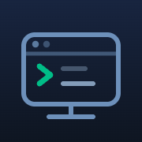
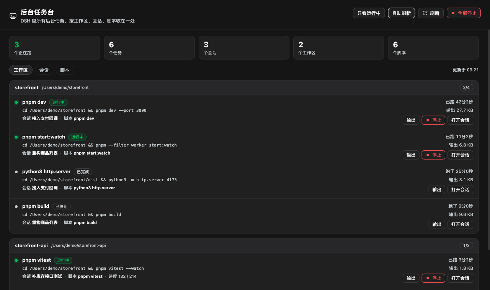
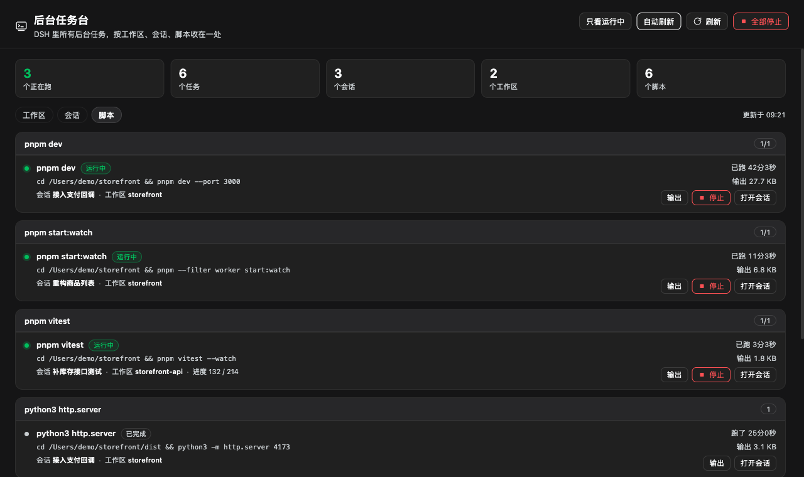
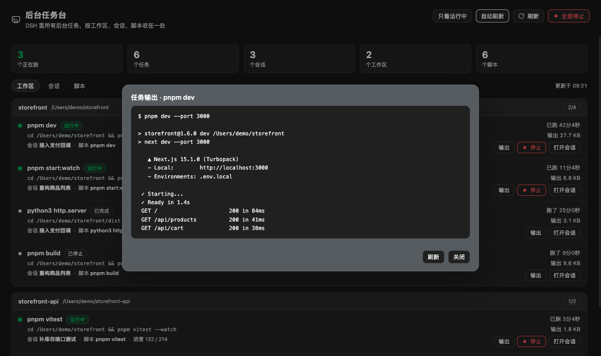

<p align="center">
  
</p>

# 后台任务台 · Background Tasks

**中文** · [English](#english)

> 你有没有这种时刻：半小时前让 agent 起了个 dev server，人早就在另一个会话里干活了，
> 8080 端口还占着，谁也说不清它到底还在不在跑。

DSH 的后台任务有个小脾气——**只按当前会话展示**。切个会话，别处那个还在吐日志的
`pnpm dev` 就从界面上消失了。于是「后台还有什么在跑」这个问题，要么靠记忆，要么靠翻聊天记录。

**后台任务台**把这笔账收在一页：所有会话的后台任务都在这里，还能用三种姿势看同一批任务
——按工作区、按会话、按脚本。看完顺手就能停掉，或者跳回发起它的那个会话。

## 长这样

| 按工作区看：这个项目里还挂着什么 | 按脚本看：`pnpm dev` 一共起了几份 |
| --- | --- |
|  |  |

点「输出」直接看它在吐什么（只读尾部，不抢模型那份）：



> 图里的项目名、路径、会话名都是演示数据。

## 三种姿势

| 视角 | 分组的键 | 一句话 |
| --- | --- | --- |
| 工作区 | 任务所属的工作区 | 「这个项目里还有什么在跑？」 |
| 会话 | 发起任务的会话 | 「这个会话留了几个后台活？」 |
| 脚本 | 从命令行里扒出来的脚本名（`cd … && pnpm dev --port 3000` → `pnpm dev`） | 「`pnpm dev` 到底开了几份？」 |

切换是瞬时的——同一份数据换个分组而已，不会重新读一遍。选过的视角记在浏览器里，刷新还在。

## 能干什么

- **一页看全**：所有会话（含子代理会话）的任务都在这儿，连「谁发起的、在哪个项目、跑的哪条
  命令、跑了多久、吐了多少输出」都标好了。
- **偷看输出**：读的是输出环形缓冲的尾巴，走非消耗读接口——**模型那份 `job_output` 游标一根
  汗毛都不会少**，它该看到的输出还在。
- **顺手停掉**：单条停有确认框，也有「全部停止」逐个收。它只认 DSH 自己的任务注册表，不碰 DSH
  进程，也不碰别人的进程。
- **跳回案发现场**：每行一个「打开会话」，直接跳到发起这个任务的那个会话（宿主提供
  `uiWorkspace` 时才有这个按钮）。
- **只看运行中**：历史任务一键藏起来。顶部那排数字会告诉你现在几个在跑、涉及几个会话/工作区/脚本。
- **自动刷新**：3 秒一次，页面切到后台就自动停手，不折腾电池。

## 安装

插件市场（[awesome-dsh-plugin](https://github.com/awesome-dsh-plugin/awesome-dsh-plugin)）收录后，
在 **插件 → 市场** 里点一下就装好。

收录前，三选一：

- **预构建包**：从 [Releases](https://github.com/zihangii/dsh-job-desk/releases/latest) 下
  `dsh-job-desk-<version>.tgz`，在 **插件 → 添加插件** 里选它。
- **本地目录**：克隆仓库，在 **插件 → 添加插件** 里选这个目录。
- **命令行**：`dsh plugin add <tarball 的 https 地址>`；profile 不是 `web` 就加 `--profile <名字>`。

装完侧栏冒出「后台任务台」，点开就用，不用重启。

## 它是怎么知道的

Host 半边只读 DSH 自己的后台任务注册表 `ctx.jobs`：

- 挨个会话要一份任务清单，再并上不属于任何会话的那些，按 id 去重；
- 会话标题问 `sessionTitle`，工作目录来自会话 header，工作区归属来自工作区注册表（工作区记着
  自己名下的会话）；
- 脚本名是从命令行里扒出来的，完整命令行照样原样展示。

浏览器半边只走一条同源接口 `/job-desk/api`，而且只认本机页面。

## 它不负责的事

- 后台任务是**进程内**的：DSH 一重启，它们就没了，任务台也就空了——这不是 bug。
- 只列 DSH 的后台任务。用 `nohup` 之类甩出去、脱离任务注册表的进程，这里看不见（那类「进程和
  端口」可以看看 [dsh-app-radar](https://github.com/zihangii/dsh-app-radar)）。
- 输出只是环形缓冲的最后一段，更早的被丢了会明确告诉你。
- 「打开会话」依赖宿主提供 `uiWorkspace`；没有就不显示这个按钮，其它照常。

## 想改它

没有构建步骤：`index.js` 是 Host 半边（Cordis 插件），`client.js` 是浏览器半边
（`window.__ModuleLoader__` 工厂），`cordis.patch.yml` 负责把插件行插进去。改完把目录重装一次就行。

```
index.js          Host 半边：汇总任务、停止、输出尾部，/job-desk/api
client.js         浏览器半边：侧栏入口 + 主区域任务台
cordis.patch.yml  插入 job-desk 这一行
locale/*.json     插件卡片的中英标题与描述
icon.svg          插件图标（矢量）
assets/           市场卡片图标 + 文档截图
```

## 许可

MIT

---

<a id="english"></a>
## English

You started a dev server in one session, moved on, and half an hour later nobody can tell whether
the thing on port 8080 is still alive. DSH shows background tasks only inside the session that
started them, so the answer is usually "scroll back and hope".

**Background tasks** puts every session's jobs on one page, and lets you look at the same set from
three angles — by workspace, by session, or by script — then inspect a job's output tail, stop it,
or jump back to the session that started it.

- **One page, every session**: what is running, in which project, with which command, for how long,
  and how much it has printed.
- **Peek at output without stealing it**: the tail is read through the non-consuming read, so the
  model's own `job_output` cursor is untouched.
- **Stop anything**, one job or all of them, behind a confirmation that spells out the scope. DSH
  itself and processes outside its job registry are never touched.
- **Jump to the owning session**, when the host provides `uiWorkspace`.

Install: one click in the plugin market once listed; before that, use the prebuilt `.tgz` from
Releases or add the cloned directory under **Plugins → Add plugin**. No restart needed.

Limitations: jobs live in the process, so a DSH restart clears them; only DSH jobs are listed (not
`nohup`-style processes); output is the tail of a bounded ring buffer and says so when earlier bytes
were evicted. MIT licensed.
